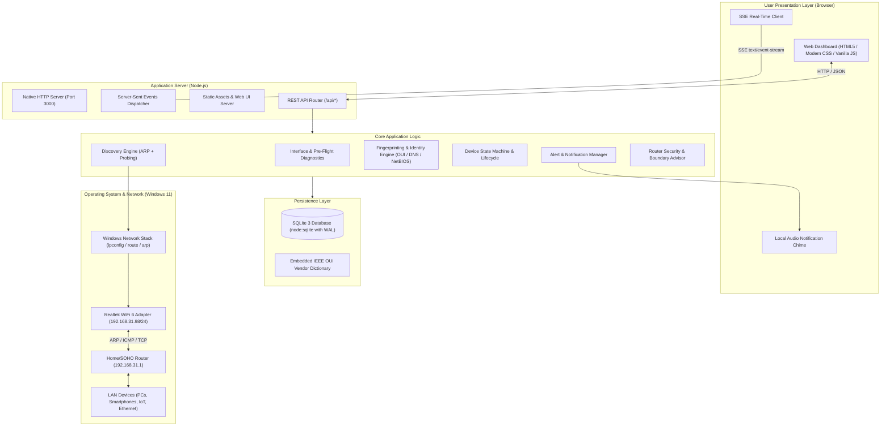
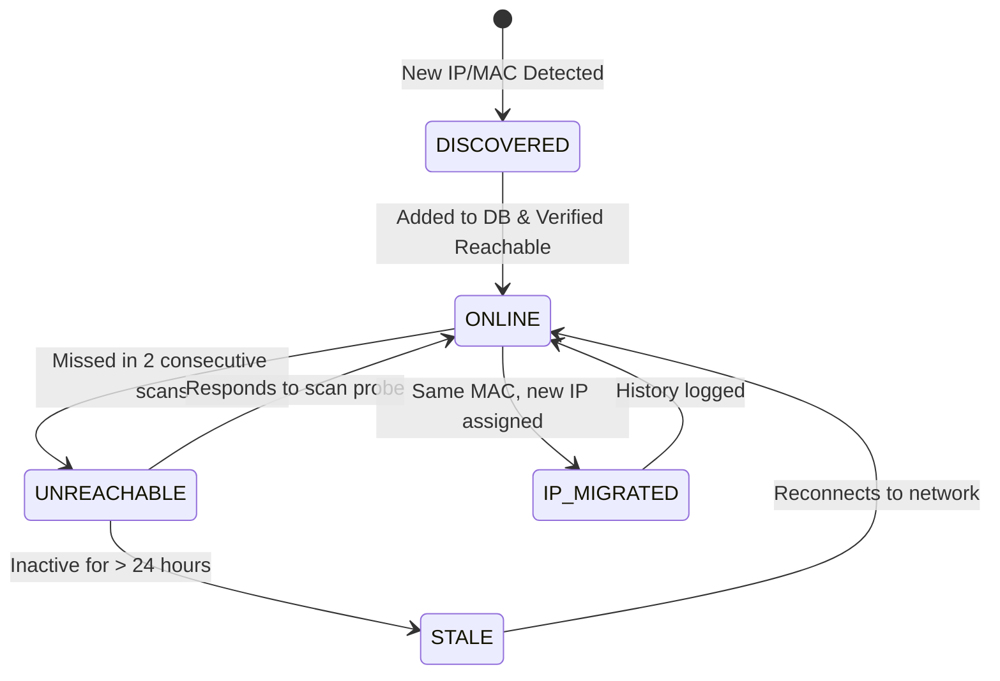
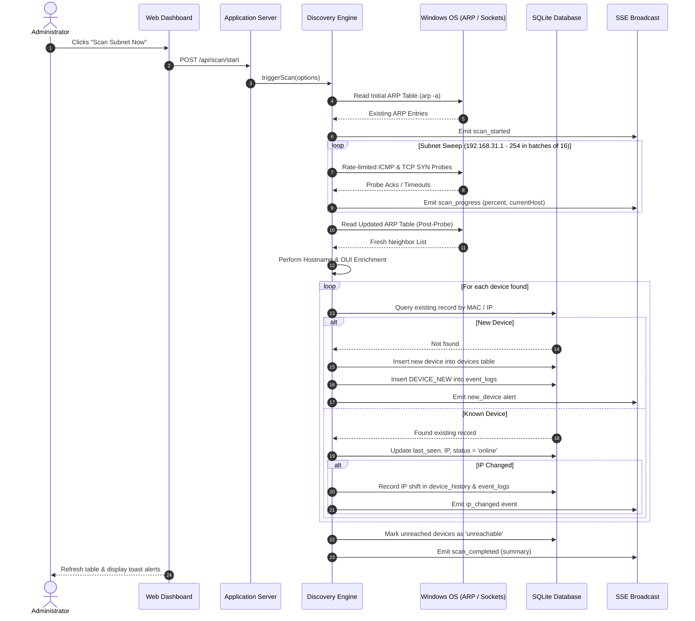
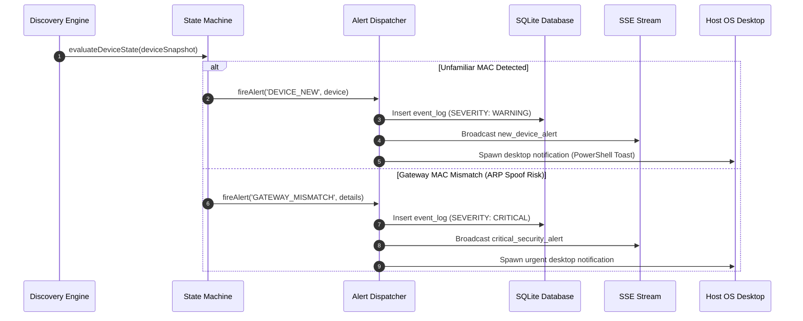
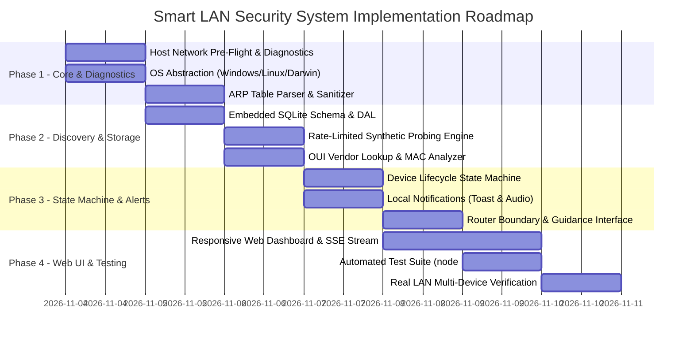

# System Architecture & Detailed Design (Design.md)
## Smart LAN Security System (v1.0)

**Document Version:** 1.0.0  
**Status:** Approved for Implementation  
**Target Environment:** Windows 11 (Inspected Host) with Linux / macOS Cross-Platform Support  
**Primary Runtime:** Node.js v22.14.0 (Native `node:sqlite`, HTTP/SSE, ESM/CJS)  
**Location:** `e:\Lan project 2.0\Design.md`  

---

### 1. Architectural Philosophy & Principles

The Smart LAN Security System is built upon four fundamental engineering principles:

1. **Honest Networking:** Never claim capabilities that standard PC hardware and operating systems cannot deliver. We do not claim to sniff traffic between third-party devices on switched Ethernet or Wi-Fi, nor do we claim to "kick off" or "block" devices without verified router firmware APIs.
2. **Defensive & Rate-Limited Probing:** Scanning must never degrade local network throughput, trigger router CPU spikes, or disrupt VoIP / streaming. All active probing uses strict concurrency limits and sliding-window delays.
3. **Privacy-Preserving & Zero-Cloud:** All data remains strictly within the local host's SQLite database. No analytics, no telemetry, no cloud relays, no plain-text credentials.
4. **Resilient to Network Imperfections:** Firewalled hosts, randomized MAC addresses, mobile phones in deep sleep, and DHCP turnover are treated as first-class states rather than anomalies or errors.

---

### 2. High-Level Subsystem Architecture



---

### 3. Detailed Subsystem Specifications

#### 3.1 Network Interface & Pre-Flight Diagnostics Engine
- **Responsibility:** Determine the host computer's active network adapter, IP configuration, gateway reachability, and network boundary conditions before initiating discovery.
- **Workflow:**
  1. Inspect network interfaces using OS-specific commands (`ipconfig /all` and `route print` on Windows).
  2. Identify the active default route (`0.0.0.0` with gateway `192.168.31.1`).
  3. Locate the corresponding adapter (`Realtek RTL8852BE-VS WiFi 6 802.11ax PCIe Adapter`).
  4. Extract:
     - IP Address: `192.168.31.98`
     - Subnet Mask: `255.255.255.0`
     - CIDR Prefix: `/24` (usable hosts: `192.168.31.1` to `192.168.31.254`, broadcast: `192.168.31.255`)
     - Default Gateway: `192.168.31.1`
     - Host MAC: `28:2E:89:01:D4:2E`
  5. Check for **Client/AP Isolation** warnings: If after a full scan only the gateway is visible while other known devices are present, warn the user that the router's AP Isolation or Guest Wi-Fi setting may be blocking inter-client communication.

#### 3.2 Discovery & Probing Engine
- **Dual-Mechanism Strategy:**
  1. **Passive ARP Table Ingestion:** Instantly reads OS neighbor cache (`arp -a` or `Get-NetNeighbor`). Devices already actively communicating with the host or gateway are discovered immediately without any network traffic.
  2. **Active Synthetic ARP Seeding:** To discover silent devices (e.g., IoT sensors, idle laptops):
     - Generate candidate IP list for the `/24` subnet.
     - Dispatch rate-limited probes. Probing sends a lightweight TCP SYN packet to common ports (`80`, `443`, `22`, `445`, `5357`) and a quick ICMP Echo.
     - **Why this works without firewall bypass:** Even if the destination device has a firewall that drops all incoming TCP and ICMP packets, the **local Windows kernel must first resolve the destination IP to an Ethernet MAC address via ARP broadcast**. Once the target responds to the ARP request at Layer 2, its MAC is recorded in the Windows ARP cache, regardless of whether the Layer-3/4 packet is dropped!
  3. **ARP Table Re-read:** The engine re-reads the OS ARP table immediately following the probe sweep to capture all newly populated Layer-2 neighbors.
- **Rate-Limiter & Concurrency Controller:**
  - Token-bucket sliding window with max 16 concurrent host checks.
  - Inter-batch spacing of 25 ms.
  - AbortController support enabling immediate scan cancellation when the user clicks "Stop Scan".

#### 3.3 Device Fingerprinting & Enrichment Module
- **Hardware Vendor (OUI Lookup):**
  - Extract the first 3 octets (24 bits) of the MAC address.
  - Query an internal indexed dictionary of official IEEE OUI allocations.
  - Map to manufacturer names (e.g., `28:2E:89` -> `Realtek Semiconductor`, `B8:27:EB` -> `Raspberry Pi Foundation`, `F0:18:98` -> `Apple, Inc.`).
- **Randomized / Private MAC Detection:**
  - Inspect bit 1 of octet 0. If set (`mac[1] & 2 !== 0`), flag as `is_randomized = true`.
  - The UI highlights this with a badge: `[Private / Randomized MAC]`, informing the administrator that mobile devices (iOS Private Wi-Fi Address, Android MAC Randomization, Windows Random Hardware Addresses) may periodically present a new MAC address upon reconnecting.
- **Multi-Protocol Hostname Resolution:**
  - **Level 1 (DNS PTR):** Queries local router DNS resolver for reverse PTR record (`98.31.168.192.in-addr.arpa`).
  - **Level 2 (NetBIOS Name Service):** Sends UDP 137 query (or runs `nbtstat -A <ip>` on Windows) to extract Windows NetBIOS computer names.
  - **Level 3 (mDNS / Bonjour):** Performs Multicast DNS query for `<ip>.local`.
  - **Fallback:** If all queries time out or are rejected, explicitly report `"(Unavailable / Firewall Blocked)"` instead of inventing names.

#### 3.4 Device Lifecycle State Machine



- **State Definitions:**
  - `DISCOVERED`: Brand new device never seen before. Triggers high-priority `DEVICE_NEW` alert.
  - `ONLINE`: Device responded to ping, TCP probe, or has an active/reachable ARP table entry within the current scan session.
  - `UNREACHABLE`: Device was previously active but did not respond in the latest scan sweep.
  - `STALE`: Device has been absent for more than 24 hours. Retained in historical inventory.
  - `IP_MIGRATED`: Known device acquired a new DHCP IP address. Previous IP archived in `device_history`.

#### 3.5 Alert & Notification Dispatcher
- **De-duplication & Throttling Window:** Mobile devices can cycle their Wi-Fi radios every few minutes to save battery. To prevent alert spam, state flapping is suppressed for 5 minutes per device.
- **Delivery Channels:**
  1. **In-Dashboard Toast & Banner:** Animated non-blocking notification cards with sound effect toggle.
  2. **Local Desktop Notifications:**
     - Windows 11: PowerShell script invoking Windows Runtime (WinRT) `ToastNotification` or native toast utility.
     - Linux: `notify-send "LAN Security Alert" "..."`
     - macOS: `osascript -e 'display notification ...'`
  3. **Searchable SQLite Audit Log:** Every security event (`DEVICE_NEW`, `IP_CHANGED`, `GATEWAY_MISMATCH`, `DEVICE_OFFLINE`) is logged with full metadata.

#### 3.6 Router Security & Boundary Advisor
- **Honest Boundary Enforcement:**
  - The application clearly states: *"Device blocking cannot be enacted from an ordinary client PC without verified router credentials."*
  - Provides a dedicated "Router Administration" card with:
    - Detected Gateway IP: `http://192.168.31.1`
    - Step-by-step instructions for popular router interfaces (TP-Link, Netgear, Asus, Xiaomi, OpenWrt, DD-WRT) to configure:
      - MAC Address Whitelisting / Filtering
      - Static IP / DHCP Address Reservation
      - Guest Network Isolation
- **Extensible Router API Plugin Interface:** An optional adapter interface (`RouterAPIAdapter`) is defined for environments with documented router APIs (such as OpenWrt LuCI REST API or AsusWRT SSH). If no router credentials are configured, blocking is gracefully displayed as *"Manual Admin Action Required"*.

---

### 4. Sequence Diagrams

#### 4.1 Subnet Discovery & Scan Cycle Flow



#### 4.2 Device State Change & Alert Flow



---

### 5. Web Dashboard UI/UX Specification

#### 5.1 Dashboard Wireframe Layout

```
+-----------------------------------------------------------------------------------------------+
| [Shield Icon] SMART LAN SECURITY SYSTEM               Host: LAPTOP-NGOP926R | IP: 192.168.31.98|
+-----------------------------------------------------------------------------------------------+
|  NETWORK OVERVIEW                                                                             |
|  [ Adapter: Realtek Wi-Fi 6 ]  [ Subnet: 192.168.31.0/24 ]  [ Gateway: 192.168.31.1 (Online) ] |
|  [ Online Devices: 4 ]         [ Offline: 1 ]               [ Untrusted / New: 1 ]            |
+-----------------------------------------------------------------------------------------------+
|  CONTROL TOOLBAR                                                                              |
|  [ Scan Now Button ]  [ Pause/Resume ]  Interval: [ Every 60s v ]  Progress: [||||||||||  ] 100%|
|  Search: [ Filter by IP, MAC, Name...   ]  Status Filter: [ All v ]  Trust: [ All v ]         |
+-----------------------------------------------------------------------------------------------+
|  DISCOVERED DEVICES TABLE                                                                     |
|  IP Address    | MAC Address       | Vendor       | Hostname       | Trust Level | Status  | Action
|  192.168.31.1  | 64:64:4A:12:34:56 | Xiaomi Comm. | miwifi.router  | Trusted     | ONLINE  | [Edit]
|  192.168.31.98 | 28:2E:89:01:D4:2E | Realtek Semi | (This Host)    | Trusted     | ONLINE  | [Self]
|  192.168.31.112| 2A:2E:89:FE:44:11 | Randomized*  | (Firewalled)   | Untrusted!  | ONLINE  | [Edit]
|  192.168.31.145| B8:27:EB:AA:BB:CC | Raspberry Pi | octopi.local   | Familiar    | OFFLINE | [Edit]
+-----------------------------------------------------------------------------------------------+
|  SEARCHABLE AUDIT EVENT LOG                                                    [ Clear Filter ]|
|  [02:15:20] WARNING: New device discovered at 192.168.31.112 (Randomized MAC 2A:2E:89:FE:44:11)|
|  [02:14:10] INFO: Device 192.168.31.145 went offline.                                         |
|  [02:10:00] INFO: Initial network pre-flight diagnostic completed. Gateway 192.168.31.1 verified.|
+-----------------------------------------------------------------------------------------------+
|  ROUTER GUIDANCE & BOUNDARY NOTICE                                                            |
|  * Note: Switched networks do not allow direct host-level packet sniffing or blocking.        |
|  To manage or blacklist devices, access your router administration interface: [Open 192.168.31.1] |
+-----------------------------------------------------------------------------------------------+
```

#### 5.2 Visual Indicators & Badges
- **Status Badges:**
  - `ONLINE`: Bright Emerald Green badge (`#10B981`)
  - `UNREACHABLE`: Amber Warning badge (`#F59E0B`)
  - `STALE`: Cool Slate Gray badge (`#64748B`)
- **Trust Level Tags:**
  - `TRUSTED`: Soft Blue badge with checkmark (`#3B82F6`)
  - `FAMILIAR`: Indigo badge (`#6366F1`)
  - `UNTRUSTED / NEW`: Bright Crimson Red badge with alert icon (`#EF4444`)
- **Randomized MAC Badge:**
  - Highlighted with `[Private / Randomized MAC]` tooltip explaining that the physical address was generated by the client OS to protect anonymity.

---

### 6. Edge Cases & Handling Strategies

| Edge Case | Network Reality | System Handling |
| :--- | :--- | :--- |
| **Windows / macOS Host Firewall** | Target device drops ICMP Echo and closed TCP ports entirely. | System relies on **Layer-2 ARP resolution**. Because local network communication requires ARP address resolution before transmitting Layer-3 packets, the device is discovered in the OS ARP cache even if all application ports are filtered. |
| **Client / AP Isolation Enabled** | Router blocks communication between wireless clients (common in public Wi-Fi or Guest networks). | Pre-flight check detects that only the gateway responds to ARP and ping. UI displays an **Isolation Warning Banner** explaining why other devices cannot be detected. |
| **Mobile Deep Sleep (Doze Mode)** | Smartphone enters low-power sleep; drops Wi-Fi keep-alive packets. | Device state machine transitions from `ONLINE` to `UNREACHABLE` only after missing 2 consecutive scan cycles. The UI marks it as "Intermittent / Sleeping" rather than triggering repeated rogue alarms. |
| **DHCP Address Reassignment** | Known device reconnects and DHCP server assigns a different IP address. | System matches the device by its unique `MAC_ADDRESS` primary key. The IP address is updated, the change is recorded in `device_history`, and an informational `IP_CHANGED` event is logged. |
| **Dual-Homed Computers** | A computer is connected simultaneously via Ethernet and Wi-Fi. | The computer will advertise two distinct MAC addresses (one per physical NIC) with two distinct IP addresses. The system treats them as two discrete network endpoints, allowing the admin to alias them as `Workstation-Wired` and `Workstation-WiFi`. |

---

### 7. Implementation Roadmap & Verification Milestones



#### Verification Plan
1. **Automated Verification:** Execute unit and integration tests using `node --test` covering CIDR calculations, ARP parsing, MAC randomization detection, database CRUD operations, and rate limiter behavior.
2. **Live LAN Verification on Target Windows 11 Host:**
   - Verify host detection on `192.168.31.98` with gateway `192.168.31.1`.
   - Discover at least two distinct active LAN devices on subnet `192.168.31.0/24`.
   - Confirm status reporting, manual refresh, rate limiting, and event logging.

